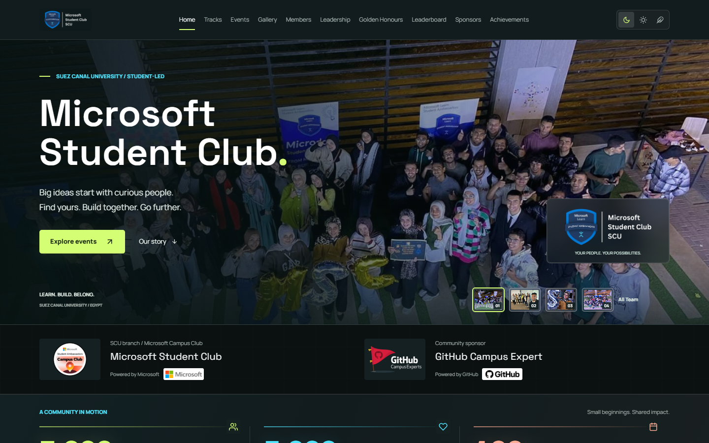
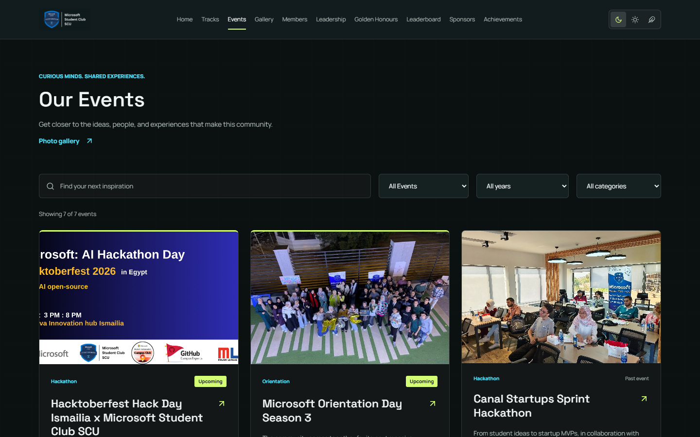
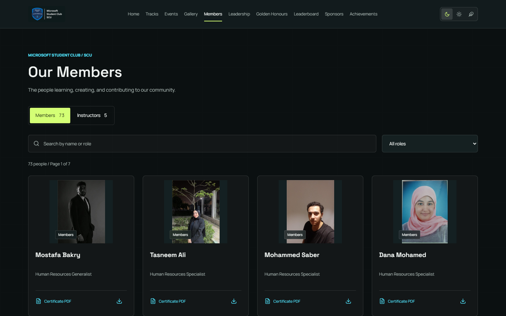
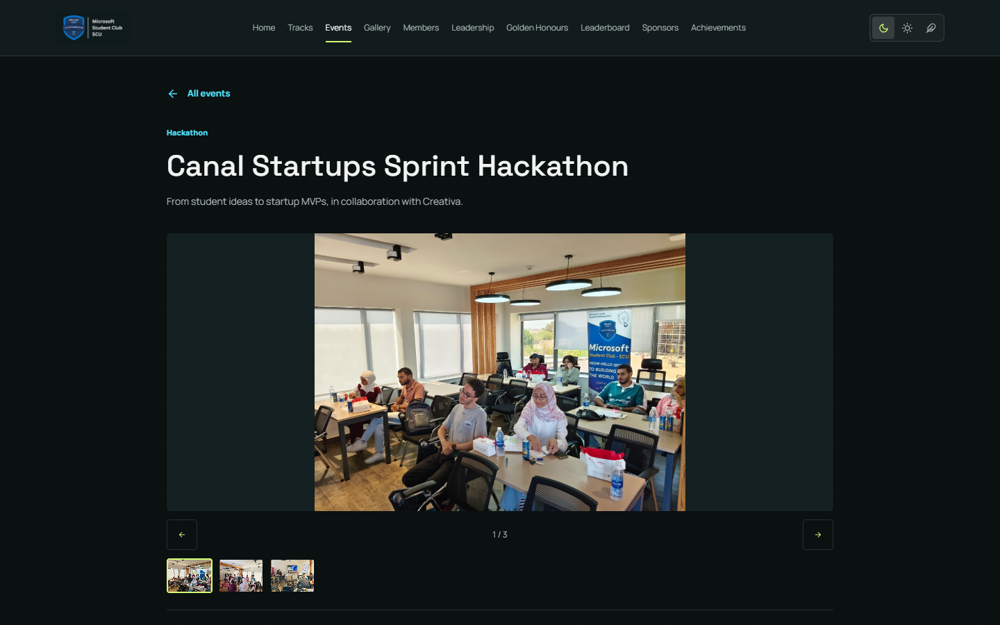
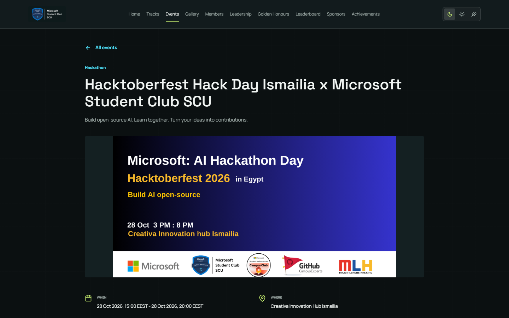
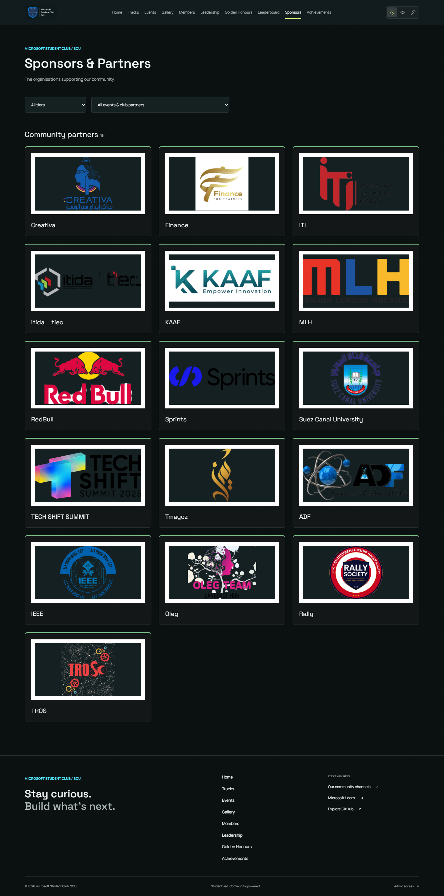
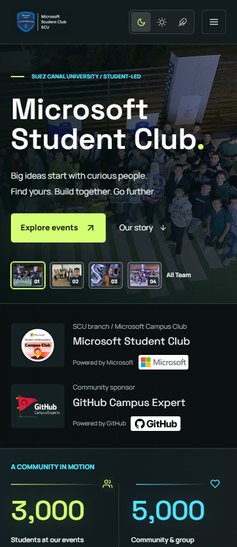
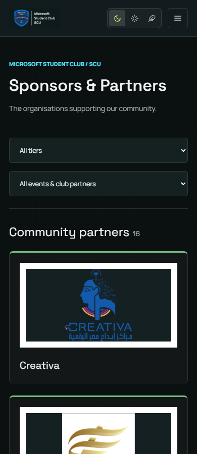

# Microsoft-Student-Club---SCU-Website-

## Live Website

**[Open Microsoft Student Club SCU](https://agreeable-rock-00f086503.5.azurestaticapps.net)**

- [Events](https://agreeable-rock-00f086503.5.azurestaticapps.net/events)
- [Members](https://agreeable-rock-00f086503.5.azurestaticapps.net/members)
- [Sponsors & Partners](https://agreeable-rock-00f086503.5.azurestaticapps.net/sponsors)
- [Admin login](https://agreeable-rock-00f086503.5.azurestaticapps.net/admin/login)

Production was verified on September 14, 2026: 101 members, 7 events and 16 published
sponsors/community partners. The homepage opens with the All Team photograph.
Hacktoberfest uses the supplied **Microsoft AI Hackathon Day (1)** poster; Canal
Startups Sprint Hackathon uses its Team photograph and a three-photo gallery.
Sponsor logos come from the approved `Sponser/Logos 1` and `Sponser/Logos 2`
catalogue. They are published as community partners without invented paid tiers.

The React frontend runs on Azure Static Web Apps and uses the ASP.NET Core API.
Production uses a **new, independent MSC_DB**; the legacy database was not changed.
Approved public images and certificates are served as static website assets.
Estimated hosting cost: **USD32.79/month**, not a spending cap.

### Production Screenshots

Actual production captures at 1440px desktop and 390px mobile, not mockups.



| Events | Members |
| --- | --- |
|  |  |

| Canal Startups Sprint Hackathon | Hacktoberfest Hack Day |
| --- | --- |
|  |  |

<details>
<summary>Sponsors and mobile screenshots</summary>






Additional mobile captures: [events](docs/screenshots/events-390.png),
[members](docs/screenshots/members-390.png),
[Canal](docs/screenshots/canal-hackathon-390.png),
[Hacktoberfest](docs/screenshots/hacktoberfest-390.png).

</details>

### Verification And Security

- 45 focused frontend tests passed for the public experience and event media.
- Six public routes passed browser checks at both viewport sizes: homepage,
  events, both updated event pages, sponsors and members. No JavaScript errors
  or horizontal overflow; team/event images and all 16 sponsor logos loaded.
- Earlier live acceptance verified 100 PDF certificates, CORS, SPA routing,
  authenticated admin login and rejection of unauthenticated writes.
- `admin-credentials.json` must remain local, outside the repository. Its filename
  is ignored at every directory level. Never commit credentials, deployment
  parameters, tokens, local backup files or deployment ZIP packages.
- If a password is exposed in chat, a commit or an artifact, rotate it. Adding a
  ignore rule does not revoke a password or erase previously published history.
- Automatic Application Insights failure-alert creation previously failed;
  alert delivery, load testing and backup restoration remain unverified.

### Push Changes And Open A Pull Request

From a feature branch, after tests and review, use PowerShell. GitHub CLI (`gh`)
must already be installed and authenticated to create the PR. These commands
publish source changes to GitHub; they do not redeploy Azure or import data.

```powershell
git status --short
git add -- .gitignore README.md docs/screenshots msc-webapp/src/content/eventsData.ts msc-webapp/src/pages/Events.test.js msc-webapp/public/club-media/hackathons
if ($LASTEXITCODE -ne 0) { throw 'Staging failed' }
git diff --cached --stat
# Review staged files before continuing. Never stage secrets or deployment ZIPs.
git commit -m "Publish live site links, event media and screenshots"
if ($LASTEXITCODE -ne 0) { throw 'Commit failed' }
git push --set-upstream origin HEAD
if ($LASTEXITCODE -ne 0) { throw 'Push failed' }
gh pr create --base main --fill
```

## Design Preview And Rollback

Public theme buttons control both the palette and the design.
The previous design remains in its original stylesheets; the new appearance is
an additive, scoped layer in `msc-webapp/src/designs/glass.css`.

- Night (moon): previous night design, with cyan text accents retained.
- Day (sun): previous day design, with readable blue text accents retained.
- Feather (Forest button): the new dark frosted-glass design, not the green palette.
- The public selection persists using `club-theme` in local storage. Previous
  `?design=glass` / `?design=classic` public URLs no longer override these buttons.
- Admin design selection remains independent, using `club-design` and the
  `?design=glass` / `?design=classic` parameters on admin routes. Admin glass uses
  a light palette to preserve existing form and status contrast.
- Images remain unblurred. Glass has opaque fallbacks for browsers without
  backdrop-filter support and for reduced-transparency preferences.

Theme mapping regression: 24 focused public-experience tests passed, including
all three buttons, persisted selection and independent admin design selection.

Earlier glass baseline: 153 frontend tests across 17 suites and TypeScript passed. Headless
Edge checked public routes and login at 320, 768 and 1440px, all three public
themes, dialog Escape behavior, design restoration and recognition photo loading.
Homepage layout also passed at 390 and 1024px. Those earlier design-only checks
did not verify live Azure authentication, database writes or deployment; see the
production verification above for the later live checks.

# GitHub Copilot Instructions - MSC-SCU Website

## Project Overview

This is a **Microsoft Student Club (SCU) website** built with a decoupled architecture:
- **Frontend**: React SPA with client-side routing
- **Backend**: ASP.NET Core Web API (RESTful)
- **Database**: Azure SQL Database with Entity Framework Core
- **Hosting**: Microsoft Azure (App Services)

## Architecture & Project Structure

### Expected Solution Layout
```
/
├── MSC.WebAPI/          # ASP.NET Core Web API project
│   ├── Controllers/     # API endpoints
│   ├── Models/          # Entity classes (Member, Event, etc.)
│   ├── Data/            # DbContext and migrations
│   └── appsettings.json # Connection strings
├── MSC.WebApp/          # React frontend application
│   ├── src/
│   │   ├── components/  # Reusable UI components
│   │   ├── pages/       # Page-level components
│   │   └── services/    # API client utilities
│   └── package.json
└── MSC.sln              # Visual Studio solution file
```

### Data Flow
1. React app makes HTTP requests to `/api/*` endpoints
2. ASP.NET Core controllers validate & process requests
3. Entity Framework Core handles database operations
4. Responses return as JSON to the frontend

## Database Schema

### Core Entities (use these exact names)
- **`Members`**: `Id`, `FullName`, `PositionTitle`, `ImageUrl`, `CertificateUrl` (nullable), `MemberTypeId` (FK), `DisplayOrder`
- **`MemberTypes`**: `Id`, `TypeName` (e.g., "High Board", "Board", "Golden Member")
- **`Events`**: `Id`, `Title`, `Description`, `EventDate`, `IsUpcoming`, `IsFeatured`, `ImageUrl`
- **`SiteContent`**: `Id`, `ContentKey`, `ContentValue` (key-value store for editable text)
- **`AdminUsers`**: `Id`, `Email`, `PasswordHash`, `Role` (enum: SuperAdmin, ContentEditor), `CreatedAt`, `LastLogin`

### Relationships
- `Members.MemberTypeId` → `MemberTypes.Id` (many-to-one)

### Image Storage Strategy
- **All images** (member photos, event images, certificates) stored in **Azure Blob Storage**
- Store only the **blob URL** in database fields (`ImageUrl`, `CertificateUrl`)
- Use separate containers: `member-images`, `event-images`, `certificates`
- Implement SAS (Shared Access Signature) tokens for secure uploads from admin panel

## API Endpoint Conventions

### Public Endpoints (no auth required)
```
GET /api/members
GET /api/members/{id}
GET /api/members/type/{typeName}
GET /api/events
GET /api/events/upcoming
GET /api/events/featured
```

### Admin Endpoints (JWT required)
```
POST /api/members
PUT /api/members/{id}
DELETE /api/members/{id}
POST /api/events
PUT /api/events/{id}
DELETE /api/events/{id}
POST /api/auth/login
POST /api/admin/users          # Super Admin only
PUT /api/admin/users/{id}      # Super Admin only
DELETE /api/admin/users/{id}   # Super Admin only
```

**Important**: All CUD (Create, Update, Delete) operations must be secured with ASP.NET Core Identity + JWT authentication.

### Authentication & Authorization
- **JWT Token Expiration**: 1 hour (no refresh token strategy required)
- **Admin Roles**:
  - **Super Admin**: Full permissions (manage content + manage admin users)
  - **Content Editor**: Limited permissions (manage content only, cannot manage users)
- Use `[Authorize(Roles = "SuperAdmin")]` for user management endpoints
- Use `[Authorize(Roles = "SuperAdmin,ContentEditor")]` for content management endpoints

## Frontend Guidelines

### Brand Color Palette (use these exact hex codes)
- **Primary Action**: `#0078d4` (buttons, links)
- **Backgrounds**: `#ffffff` (white), `#f2f2f2` (light gray section dividers)
- **Text**: `#2e2e2e` (body text), `#ffffff` (on dark backgrounds)
- **Navbar/Footer**: `#203a6c` (dark blue)
- **Accents/Hover**: `#50e6ff` (light blue)

### Component Structure
- Build reusable components: `Button`, `Card`, `Navbar`, `Footer`
- Use React Router for client-side navigation
- Fetch data via API service utilities (e.g., `apiClient.js`)

### Key Pages
1. **Landing Page**: Hero, Vision/Mission, Events (featured + upcoming), Team (Golden Members carousel)
2. **All Events Page**: List all events with filtering
3. **All Members Page**: Display by type (High Board, Board, Golden Members)
4. **Admin Dashboard**: Login + CRUD interfaces for Members and Events

## Development Workflows

### Backend Setup (First Time)
```powershell
# Install EF Core tools
dotnet tool install --global dotnet-ef

# Install required NuGet packages
cd MSC.WebAPI
dotnet add package Microsoft.EntityFrameworkCore.SqlServer
dotnet add package Microsoft.EntityFrameworkCore.Tools
dotnet add package Azure.Storage.Blobs
dotnet add package Serilog.AspNetCore
dotnet add package Serilog.Sinks.ApplicationInsights
dotnet add package Microsoft.AspNetCore.Authentication.JwtBearer
dotnet add package Microsoft.AspNetCore.Identity.EntityFrameworkCore

# Create initial migration
dotnet ef migrations add InitialCreate
dotnet ef database update
```

### Running Locally
```powershell
# Backend (run from MSC.WebAPI/)
dotnet run

# Frontend (run from MSC.WebApp/)
npm install
npm start
```

### Database Migrations
After modifying entity classes:
```powershell
dotnet ef migrations add <MigrationName>
dotnet ef database update
```

## Azure Deployment Checklist

1. **Azure SQL Database**: Provision instance and update connection string in `appsettings.json`
2. **Azure Blob Storage**: Create storage account with containers (`member-images`, `event-images`, `certificates`)
3. **App Services**: Create two App Services (one for API, one for React build)
4. **Application Insights**: Set up for logging and performance monitoring
5. **CORS Configuration**: Backend must allow requests from frontend URL
6. **Environment Variables**: Store connection strings, JWT secrets, and blob storage keys in Azure App Service configuration

## Logging & Monitoring

### Serilog Configuration
- Configure Serilog in `Program.cs` with structured logging
- Log to both console (development) and Application Insights (production)
- Use log levels appropriately: `Information` for requests, `Warning` for validation failures, `Error` for exceptions
- Include correlation IDs in logs for request tracing

### Application Insights
- Track custom events for admin actions (e.g., member created, event updated)
- Monitor API response times and database query performance
- Set up alerts for error rate thresholds

## Testing Strategy

### Backend
- **Unit Tests**: Use xUnit for service logic (e.g., filtering members by type)
- **Integration Tests**: Use `WebApplicationFactory` to test API endpoints with in-memory database
- **Auth Tests**: Verify 401 errors on secured endpoints without valid JWT

### Frontend
- **E2E Tests**: Use Cypress or Playwright to simulate user flows (e.g., navigate to events, verify data loads)
- **Admin Panel E2E**: Test login → create member → verify member appears on public site

## Critical Patterns

### Entity Framework Configuration
- Use **Code First** approach with Fluent API in `OnModelCreating` for complex relationships
- Always include `.AsNoTracking()` for read-only queries to improve performance

### API Response Format
Return consistent JSON structures:
```csharp
// Success
return Ok(data);

// Not Found
return NotFound(new { message = "Resource not found" });

// Bad Request
return BadRequest(new { errors = validationErrors });
```

### Frontend API Error Handling
Always handle network errors and display user-friendly messages:
```javascript
try {
  const response = await fetch('/api/members');
  if (!response.ok) throw new Error('Failed to fetch members');
  const data = await response.json();
} catch (error) {
  console.error(error);
  // Show error UI
}
```

### Azure Blob Storage Integration
Upload images from admin panel using Azure Storage SDK:
```javascript
// Frontend: Generate SAS token request
const response = await fetch('/api/upload/generate-sas-token', {
  method: 'POST',
  headers: { 'Authorization': `Bearer ${token}` },
  body: JSON.stringify({ containerName: 'member-images', fileName: file.name })
});
const { sasUrl } = await response.json();

// Upload directly to Blob Storage
await fetch(sasUrl, {
  method: 'PUT',
  headers: { 'x-ms-blob-type': 'BlockBlob' },
  body: file
});
```

Backend controller should generate time-limited SAS tokens (e.g., 15 minutes):
```csharp
// Generate SAS token with write permission
var sasBuilder = new BlobSasBuilder
{
    BlobContainerName = containerName,
    BlobName = fileName,
    Resource = "b",
    ExpiresOn = DateTimeOffset.UtcNow.AddMinutes(15)
};
sasBuilder.SetPermissions(BlobSasPermissions.Write);
```

## Phase-Based Development

**Current Phase**: Foundation (Phase 1)
- Focus on setting up ASP.NET Core Web API and Azure SQL Database
- Create entity models and initial migrations
- Establish project structure before implementing endpoints

**Next Phases**: Follow the sprint plan in README.md
